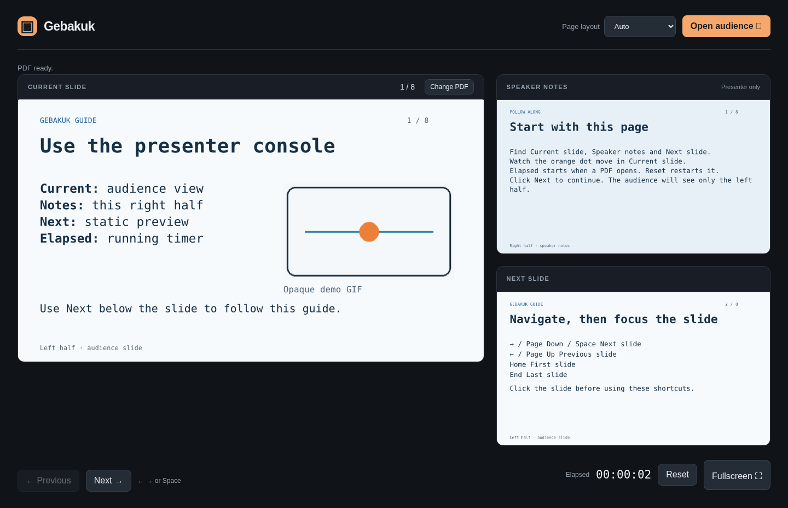

# Gebakuk

A PDF presenter that runs in your browser. It shows speaker notes and the next
slide beside your presentation, with a separate window for the audience. PDFs
are processed locally and are never uploaded.

[Open Gebakuk](https://woodruffw-trough.github.io/gebakuk/)
· [Open the guide](https://woodruffw-trough.github.io/gebakuk/?source=guide.pdf)
· [Try a real presentation](https://woodruffw-trough.github.io/gebakuk/?source=https%3A%2F%2Fraw.githubusercontent.com%2Ftrailofbits%2Fpublications%2Fmaster%2Fpresentations%2FAttestations%253A%2520a%2520new%2520generation%2520of%2520signatures%2520on%2520PyPI%2Fslides.pdf)

1. Open a PDF in **Current slide**: click to choose a file, drop one, or paste a
   URL. PDF URLs on other sites require CORS permission.
2. Choose **Open audience**, move that window to your display, and enter
   fullscreen.
3. Navigate with **←**, **→**, or **Space**. **Change PDF** opens another deck.

**Auto** detects slides with notes on the right; use **Page layout** to override
it. The [guide](https://woodruffw-trough.github.io/gebakuk/?source=guide.pdf)
covers the controls, URL links, layouts, and embedded GIFs. A current browser
with WebAssembly SIMD support is required.

The real presentation is William Woodruff's *Attestations: a new generation of
signatures on PyPI* (PyCon US 2025).

[Build and development](docs/development.md)
· [Typst GIF helper](typst/README.md)
· [Security and limits](docs/security.md)
· [License](LICENSE)
